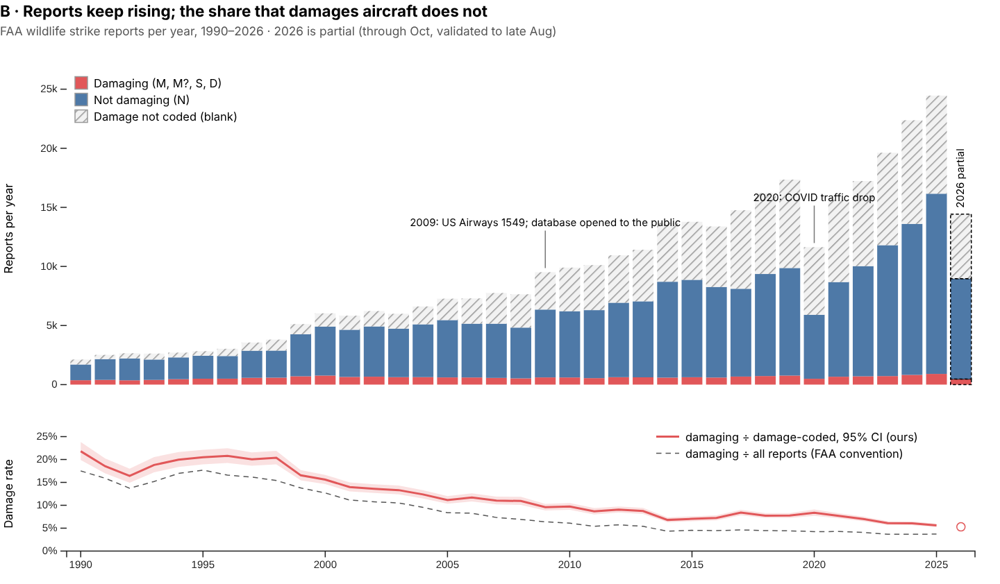
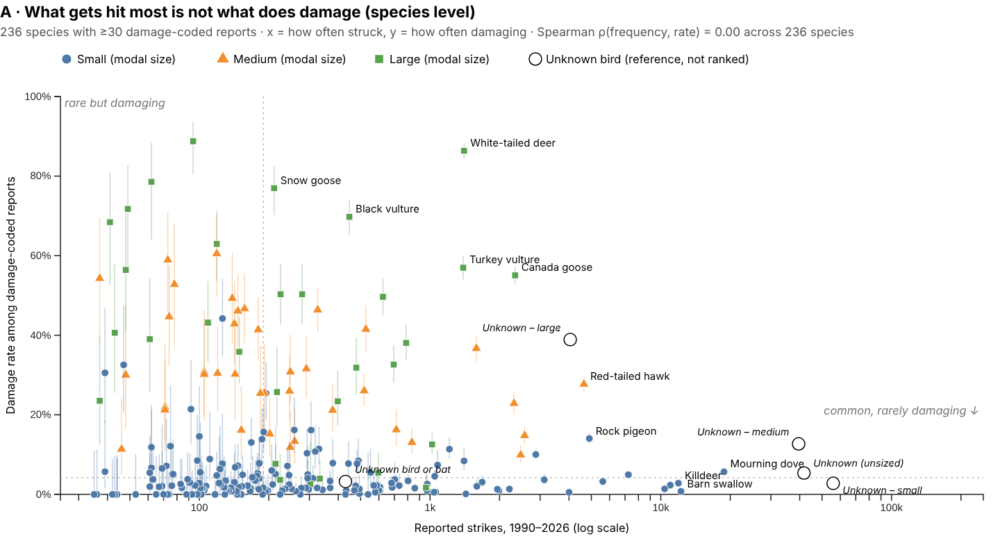
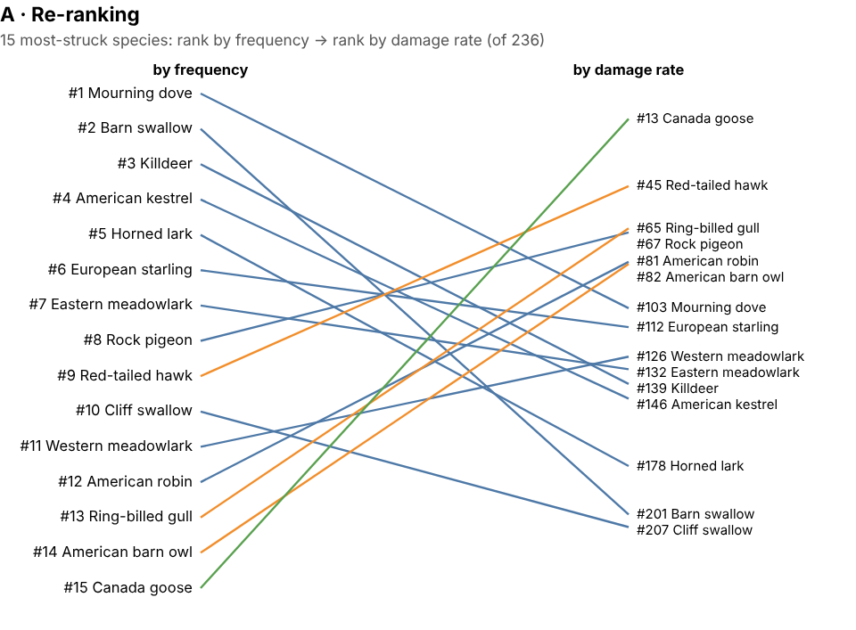
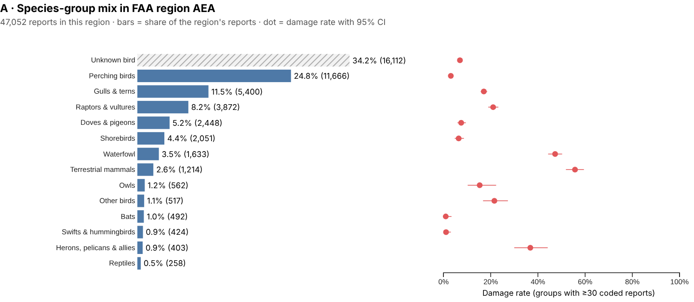
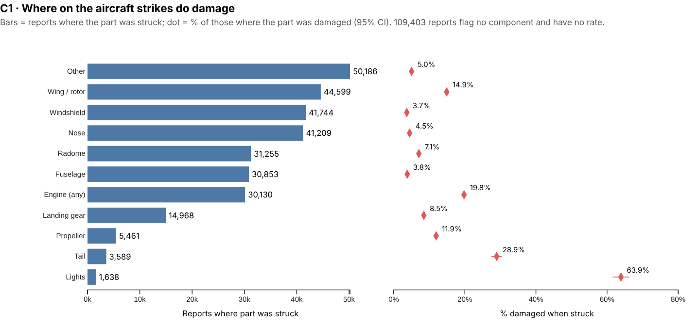
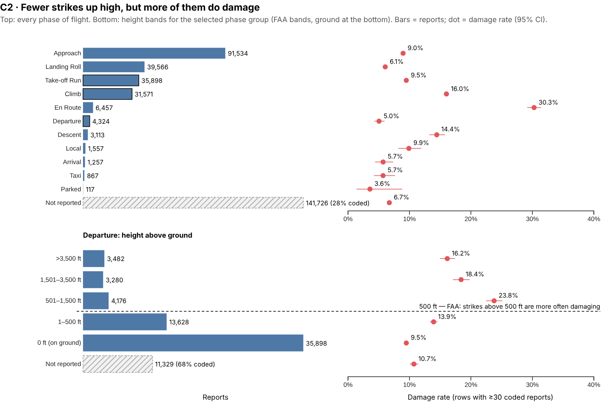
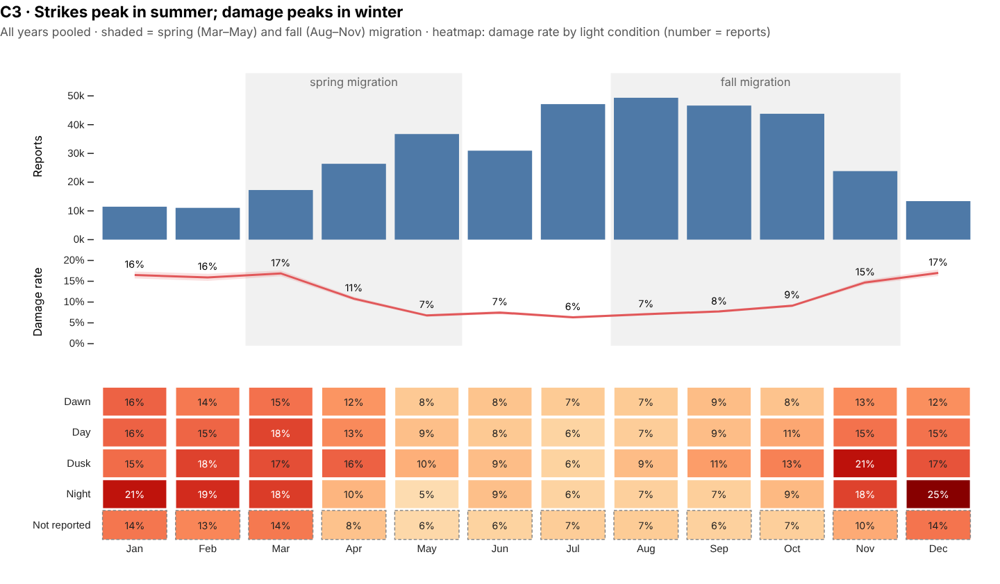
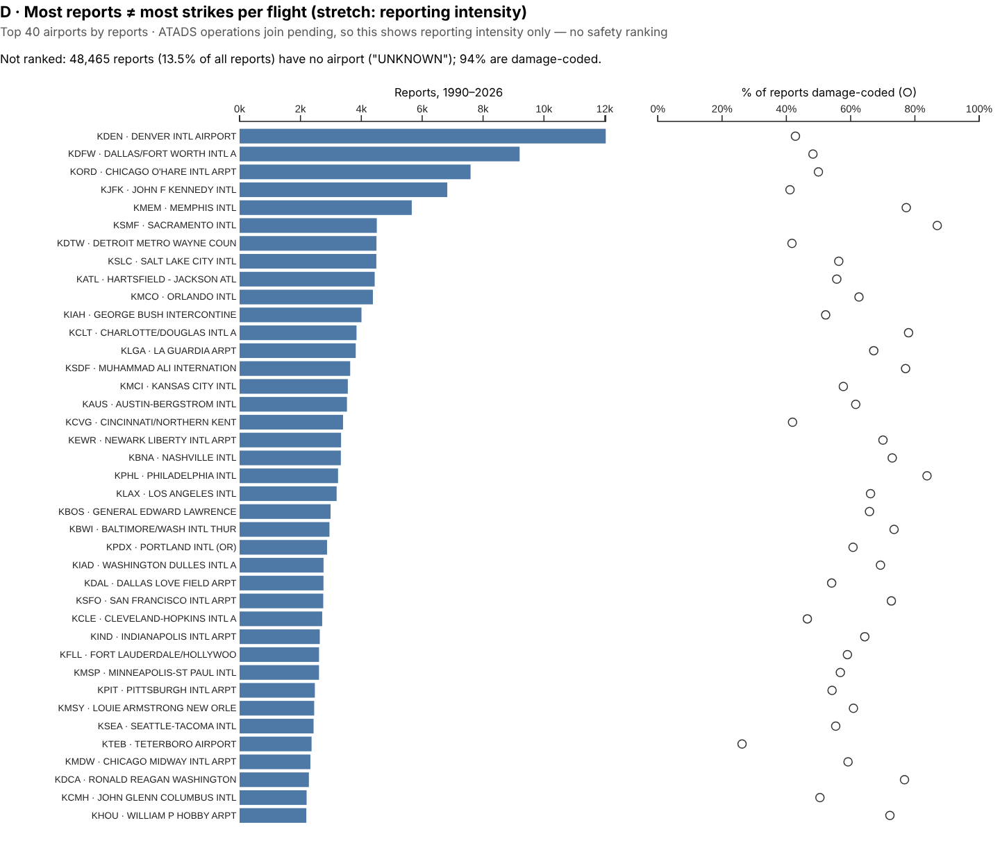
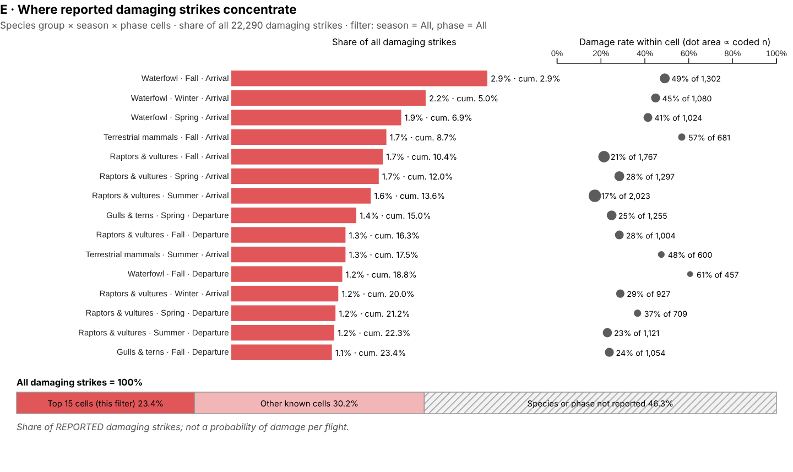

# Milestone 3 — First D3 draft

> The Milestone 2 record is kept unchanged at [milestones/milestone2.md](https://github.com/simranmultani197/struck-vs-damaged/blob/main/milestones/milestone2.md).

**Team 10: Flight Risk** · Simranjeet Singh (xs2797) · Astha Vairat (aav7237)
CS-GY 6313 Information Visualization, NYU Tandon, Fall 2026 · Milestone 3: first D3 draft

Wildlife strikes are a growing aviation hazard. The FAA National Wildlife Strike Database holds 357,987 reports
filed between 1990 and October 2026, and the number filed each year is at a record high. Airports have limited
budgets for wildlife control, so knowing *what gets hit most* is less useful than knowing *what actually damages
aircraft*. This draft shows that these two rankings are close to unrelated, then breaks the gap down by
aircraft component, flight phase and height, season and time of day, and airport, and finally asks where
reported damaging strikes are concentrated.

**How to read the charts.**
- *Damage rate* = damaging strikes (FAA damage level M, M?, S or D) ÷ strikes whose damage level was recorded
  ("damage-coded"). Each rate is shown with a 95% Wilson confidence interval.
- Missing values are never dropped. "Not reported" rows, "Damage not coded" bars and "Unknown bird" markers stay
  on the charts, mostly with hatching or hollow marks.
- **Hover any bar, dot or cell** to see the exact counts, the denominator and the interval behind it.

**Changes since Milestone 2.**
- All views are now built in D3.
- The Q2 region filter became its own panel, so a region's species mix is readable.
- Cross-view linking (brushing species in View A to filter Views C and E) is moved to Milestone 4. The processed
  tables are aggregated separately for each view, so linking them needs one combined table of species group ×
  phase × season × month, which we will build next.
- Every view already has its own working controls.

## How to view and run

1. **Observable notebook (main delivery):** https://observablehq.com/d/459b21075dde1498. The notebook runs every view live, with its controls, and contains all of the D3 code in its last cell (the *D3 code* cell). It loads data straight from this repository.
2. **Run it locally (no Observable needed):**
   ```bash
   git clone https://github.com/simranmultani197/struck-vs-damaged.git
   cd struck-vs-damaged
   python3 -m http.server 8000
   # open http://localhost:8000/milestone3/index.html
   ```
   The page loads d3 v7 from jsDelivr and the CSVs from `data/processed/`.
3. **Rebuild the notebook cells and this write-up** after editing `views.js` or `content.py`: `python3 milestone3/build_notebook.py`.

| File | Purpose |
| --- | --- |
| `milestone3/views.js` | All D3 view functions (one per chart) and shared helpers |
| `milestone3/index.html` | Local page that renders every view with its controls |
| `milestone3/observable/cells_notebook2.js` | The cells of the published notebook (Observable Notebooks 2.0, plain-JavaScript cells), in order |
| `milestone3/observable/cells.js` | The same notebook in classic Observable syntax (for classic notebooks) |
| `milestone3/content.py`, `build_notebook.py` | Write-up text and the script that builds `cells.js` and this README |
| `milestone3/screenshots/` | Static captures of each view, used below |

## Q1 · View B

**Question.** How many wildlife strikes are reported each year, and how has that changed from 1990 to 2025?



- **Top panel:** stacked bars of reports per year, split into damaging (red), not damaging (blue) and
  damage not coded (hatched).
- **Bottom panel:** the damage rate per year with its 95% interval (red), plus the FAA's own convention of
  damaging ÷ all reports (dashed).

**What it shows.**
- **Reports rose 11.5×**, from 2,120 in 1990 to 24,457 in 2025, with a visible dip in 2020 (COVID traffic).
- **The damage rate fell** over the same period, from 21.8% to 5.6% (FAA convention: 17.5% to 3.7%).
  The rise in volume is therefore not a rise in severity. It fits the FAA's reading that small, harmless strikes
  are now reported far more often.
- **The hatched share grows over time.** Damage was coded for 80% of reports in 1990 but only 51% in 2020 and
  66% in 2025, which is why every later rate uses coded records as its denominator.
- 2026 is drawn with a dashed outline and a hollow rate point because it is incomplete.

**Interaction:** toggle the y-axis between counts and share of reports, and hover a year for all of its counts
and rates.

**D3 code:** `viewB` ([views.js line 49](views.js#L49)), also in the notebook's *D3 code* cell.

## Q2–Q3 · View A

**Question.** Which species are struck most often, which most often damage the aircraft when struck, and how different are the two rankings? Does the species mix differ across FAA regions?







- **Main scatter:** each of the 236 species with at least 30 damage-coded reports is one mark.
  - x = how often it is struck (log scale); y = how often its strikes cause damage, with a 95% interval.
  - Shape and color both show the bird's most frequently reported size.
  - Hollow rings are the "Unknown bird" categories, shown for reference but not ranked.
- **Slope chart:** re-ranks the 15 most-struck species by damage rate.
- **Region panel:** a selected FAA region's species-group mix, with each group's damage rate.

**What it shows.**
- **The two rankings are unrelated** (Spearman ρ = 0.00).
  - The most-struck birds sit bottom right: mourning dove (18,788 reports, 5.7% damaging) and barn swallow
    (12,233 reports, 0.8%).
  - The most damaging sit top left and centre: white-tailed deer (1,404 reports, 86.4%), black vulture (69.8%),
    Canada goose (55.1%).
- **Bird size explains part of the gap but not all of it.** Faceting by size shows that species within each size
  class still spread widely.
- **In the slope chart only two of the 15 most-struck species rank in the top 50 by damage rate:** Canada goose
  (#13) and red-tailed hawk (#45). Barn swallow drops to #201.
- **The unknown rings matter.** "Unknown bird – medium" (12.7% damaging) and "– large" (38.9%) together hold a
  large share of damaging strikes that have no species attached.
- **In the region panel, waterfowl's share varies widely by region:** 12.2% of Alaskan reports, but under 1% in
  the Southern and Southwest regions. Their damage rate stays at 33–62% everywhere, so region changes the mix
  more than the severity.

**Interaction:**
- Switch between species and family level.
- Facet by size.
- Type a name in *Highlight* to dim everything else.
- Hover for counts, intervals and both ranks.
- Pick a region in the region panel.

**D3 code:** `viewA` ([views.js line 130](views.js#L130)), `viewASlope` ([views.js line 211](views.js#L211)), `viewARegion` ([views.js line 239](views.js#L239)), also in the notebook's *D3 code* cell.

## Q4 · View C1

**Question.** Which aircraft components are struck most often, and which strikes most often damage that component?



- **Left:** reports in which each component was struck.
- **Right:** the share of those strikes that damaged the component, with a 95% interval.

**What it shows.** The frequency–severity split repeats on the aircraft itself.
- **Most struck, least damaged:** the wing/rotor, windshield and nose are struck most (41,000–45,000 reports
  each), yet are damaged in only 3.7–14.9% of those strikes.
- **Engines** are struck less often (30,130 reports) but damaged 19.8% of the time; the tail 28.9%.
- **Lights** show 63.9%, probably because a light strike is mostly reported when the light breaks.
- **109,403 reports flag no component.** They are stated in the subtitle because they have no rate to plot.

**Interaction:** sort by reports struck or by damage rate; hover for the part-level and whole-aircraft damage
rates.

**D3 code:** `viewC1` ([views.js line 266](views.js#L266)), also in the notebook's *D3 code* cell.

## Q5 · View C2

**Question.** In which phase of flight and at what height do strikes occur, and how does the damage rate change across them?



- **Top:** every phase of flight, with bars for reports and dots for damage rate.
- **Bottom:** the FAA height bands for a selected phase group, drawn ground-up like an altitude profile, with a
  500 ft reference line.

**What it shows.**
- **Approach** has by far the most reports (91,534) but a 9.0% damage rate. **En route** strikes are rare
  (6,457) but damaging 30.3% of the time. Climb (16.0%) is clearly worse than the take-off run (9.5%).
- **Damage rises with height.** On departure the rate climbs from 9.5% on the ground to 23.8% at 501–1,500 ft.
  On arrival it rises from 6.1% to about 11–12% above 500 ft. This matches the FAA's finding that strikes above
  500 ft are more often damaging.
- **The hatched "Not reported" phase is the largest single row** (141,726 reports), and only 28% of it is
  damage-coded.

**Interaction:** choose the phase group (departure, arrival, en route, local) for the height profile; hover any
row for counts and intervals.

**D3 code:** `viewC2` ([views.js line 302](views.js#L302)), also in the notebook's *D3 code* cell.

## Q6 · View C3

**Question.** What is the seasonal and time-of-day signature of strikes, and does it line up with migration?



- **Top:** reports per month (bars) and damage rate per month (line with a 95% band), with the
  spring and fall migration windows shaded.
- **Bottom:** a month × light-condition heatmap. The "Not reported" row is outlined, and cells with fewer than 30
  coded reports are greyed out.

**What it shows.**
- **Peak volume and peak damage fall in different seasons.** Reports peak July–September (about
  46,000–49,000 a month) when the damage rate is lowest (6–8%). The damage rate peaks December–March (16–17%)
  when reports are fewest.
- **Fall migration sees severity rise** toward November (15%).
- **The heatmap points to winter nights:** December night strikes are damaging 24.5% of the time and January
  nights 20.8%. November dusk is also high (20.9%).
- **Our reading is that this is a change in species mix** (fewer small birds, more waterfowl and deer), which
  linked filtering will test in Milestone 4.

**Interaction:** switch the heatmap between damage rate and report counts; hover any month or cell.

**D3 code:** `viewC3` ([views.js line 356](views.js#L356)), also in the notebook's *D3 code* cell.

## Q7 · View D

**Question.** (Stretch) Which airports have the most reports, and how much of that reflects reporting practice rather than hazard?



- The 40 airports with the most reports, as bars.
- The share of each airport's reports that are damage-coded, as rings.
- The "UNKNOWN" airport, stated above the chart and not ranked.

**What it shows.**
- **Denver has the most reports (12,030), but only 43% are damage-coded.**
- **Coding completeness ranges from 26% (Teterboro) to 87% (Sacramento).** Raw counts therefore largely measure
  how thoroughly an airport reports.
- **48,465 reports (13.5%) have no airport at all.**
- **This is the fallback version.** The FAA ATADS operations join, which would turn counts into strikes per
  100,000 operations, is still pending, so the chart makes no safety ranking.

**Interaction:** sort by reports, % damage-coded or damage rate; hover for details.

**D3 code:** `viewD` ([views.js line 404](views.js#L404)), also in the notebook's *D3 code* cell.

## Q8 · View E

**Question.** Taken together, which combinations of species group, season and flight phase account for the largest share of reported damaging strikes?



- **Ranked bars:** the top 15 species-group × season × phase cells, as a share of all 22,290 damaging
  strikes, with the running cumulative share.
- **Dots:** the damage rate inside each cell (dot area ∝ coded reports), so common-and-mild cells can be told
  apart from rare-and-severe ones.
- **Bottom bar:** all damaging strikes split into the top cells, the other known cells, and the block with no
  species or phase.

**What it shows.**
- **Waterfowl on arrival lead** in fall, winter and spring.
- **Raptors and vultures** appear in almost every season, at lower damage rates (17–37%).
- **Arrival cells account for 28.7% of all damaging strikes** and departure cells 20.3%.
- **The top 15 cells hold only 23.4%.**
- **The largest block, 46.3%, has no species or no phase reported.** That limits any recommendation, so the
  caption keeps the claim to *reported* damaging strikes.

**Interaction:** filter by season and phase group, and the ranking and the 100% bar recompute; hover for counts
and in-cell rates.

**D3 code:** `viewE` ([views.js line 435](views.js#L435)), also in the notebook's *D3 code* cell.

## Next steps

**Next (Milestone 4).**
- Build the linked filter state (species ↔ phase ↔ season) on a combined aggregate table.
- Add a Pareto line to View E.
- Join the ATADS operations for View D.
- Polish layout, color and annotations, and write the narrative article.

## AI-use statement

**Tools.** Claude (Anthropic), the Claude Opus model, used through the Claude desktop app (Cowork mode). No other
AI tools were used for this milestone.

**Where we used AI.**
1. *Debugging and recommendations.* We wrote the D3 view code ourselves from our Milestone 2 sketch specifications:
   - `milestone3/views.js`
   - the local preview page `milestone3/index.html`
   - the notebook build script, and the Observable cell file it produces.

   We used Claude as a debugging and review aid: we pasted error messages and code snippets to help find bugs,
   asked for suggestions when labels overlapped or encodings were unclear, and asked about D3 APIs and
   good practice (scales, transitions, handling missing data). We decided which suggestions to use and
   wrote or adapted the code ourselves.
2. *Earlier milestones.* We used AI to brainstorm project ideas, review the proposal and the instructor feedback,
   check FAA definitions, draft parts of the data pipeline and report text, debug code, and draft README sections.

**What is our own work.**
- The project question and the analysis decisions: denominators, the damaging-strike definition, handling of
  missing data, descoping.
- The data pipeline design and its outputs.
- The D3 implementation of all views.
- The written descriptions in this write-up.
- The choice of views and interactions.
- Testing and verification of the visualizations.

In this milestone we wrote the D3 code, and Claude helped with debugging, code review and
design recommendations. The implementation, testing and decisions were ours.

**Verification.** Every figure quoted here can be reproduced from the CSVs in `data/processed/`, which are produced
by `pipeline/build.py` from the FAA download.
